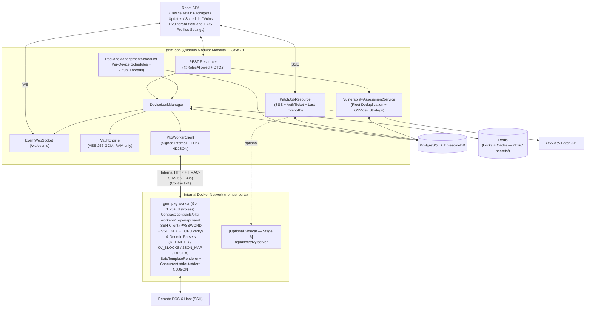

# Package, Update, Patch & Vulnerability Management Architecture (Core + Stateless Go Worker)

**Status:** Approved Architectural Decisions (ADR-0..9)  
**Implementation Plan (TDD):** [`plans/package-management-plan.md`](../plans/package-management-plan.md)  
**Input Specification:** [`docs/ne-updates.md`](ne-updates.md)  
**Project Invariants:** [`.agents/invariants.md`](../.agents/invariants.md)

---

## 1. Purpose, Scope & Container Split

This module adds an agentless package, update, patch, and vulnerability management system to **GreatNetworkManager / LanAlmanac** for **POSIX/SSH hosts (Linux, BSD, network/IoT appliances — no Windows support)**:
1. Installed package inventory (**Inventory**),
2. Non-invasive available update detection (**Update Check**),
3. Controlled patch execution with live console log streaming (**Patch Execution** — triggered manually from the GUI or via per-device schedules),
4. Passive server-side CVE correlation (**Vulnerability Assessment**).

**Core Architectural Principles:**
1. **Zero hardcoded OS logic in application code** (in both `gnm-app` and `gnm-pkg-worker`) — supporting a new Linux distribution, BSD variant, or network appliance requires only adding or cloning a declarative `os_profile` in the UI or importing a versioned JSON profile (`schemaVersion: 1`).
2. **Replaceable, stateless execution worker `gnm-pkg-worker` (Go 1.23+)** behind a versioned internal contract `contracts/pkg-worker-v1.openapi.yaml` — the worker can be replaced or scaled independently without touching PostgreSQL, `VaultEngine`, Auth/RBAC, REST APIs, or the React frontend.
3. **TDD-first:** every component (Go worker, Quarkus core, RBAC resources, contract tests, and UI E2E tests) is developed using **Red → Green → Refactor**.

### Responsibility Boundary

| Area | `gnm-app` (Core — Quarkus / Java 21) | `gnm-pkg-worker` (Stateless Container — Go 1.23+) |
| :--- | :--- | :--- |
| **PostgreSQL / Flyway** | **Sole owner** of all tables and migrations (`V24`–`V28`) | **Zero DB access** |
| **`VaultEngine` & Secrets** | **Sole owner** of the master key and encrypted credentials | Receives decrypted secret in RAM only for a single request to a TOFU-trusted host; immediately zeroizes buffer; zero persistence to disk/logs/Redis |
| **TOFU (`sshHostKeyTrusted`)** | Stores trust state, manages `trust-ssh`, records `ThreatEvent` | Verifies host fingerprint against `expectedHostKeySha256` **before** authentication; aborts on mismatch with `HOST_KEY_MISMATCH` |
| **Auth / RBAC / UI / SSE / WS** | `@RolesAllowed`, `AuthTicketService`, browser SSE streams, `/ws/events`, React UI | Zero host ports; internal Docker network only + HMAC-SHA256 request signing |
| **Orchestration, Locks & Schedules** | `DeviceLockManager`, `OsProfile` CRUD, `ProfileValidator`, `PatchJob` audit log, `DevicePackageSchedule` + `PackageManagementScheduler` | Stateless single-operation executor (+ in-memory active `executionId` map for `/cancel`) |
| **SSH Transport, Parsers & Execution** | HTTP/NDJSON client `PkgWorkerClient` | `golang.org/x/crypto/ssh` (`PASSWORD` + `SSH_KEY`), POSIX probe, 4 generic parsers, concurrent `stdout`/`stderr` reader, NDJSON streaming |
| **Step 4 — Vulnerabilities (CVE)** | `VulnerabilityAssessmentService` + `OsvApiVulnerabilityProvider` (MVP) behind `VulnerabilityProvider` | Not involved (optional future `aquasec/trivy server` sidecar in Stage 6) |

---

## 2. High-Level Architecture



---

## 3. Versioned Internal Contract: `contracts/pkg-worker-v1.openapi.yaml`

The contract is the single source of truth between `gnm-app` and `gnm-pkg-worker`. Every worker implementation change is verified by the **Contract Test Suite** (`PkgWorkerContractTest`).

### 3.1 Core ↔ Worker Channel Security
1. **Network Isolation:** `gnm-pkg-worker` is attached only to the internal Docker network, with **no `ports:` mapping**.
2. **HMAC-SHA256 Signature + Anti-Replay:** Every request includes:
   * `X-GNM-Timestamp`: Unix epoch seconds (±30s replay window),
   * `X-GNM-Signature`: `HMAC-SHA256(sharedSecret, method + "\n" + path + "\n" + timestamp + "\n" + sha256(body))` (constant-time verification; `GNM_PKG_WORKER_AUTH_SECRET` must be at least 32 bytes).
3. **TOFU Policy & Secret Zeroization:**
   * `gnm-app` **never** decrypts or transmits credentials for a host whose `sshHostKeyTrusted != true`.
   * Initial host key discovery uses `POST /v1/ssh/fingerprint` **without credentials** (KEX handshake only).
   * All other endpoints require `target.expectedHostKeySha256`. The worker verifies the host key before attempting authentication (`HOST_KEY_MISMATCH` returns `actualFingerprint`).
   * Inside the Go worker, secret byte buffers (`auth.secret` and future `sudoSecret`) are overwritten with zeros (`clear(buf)`) immediately after SSH authentication; request bodies are never logged.

### 3.2 Contract `v1` Endpoints

| Endpoint | Method | Content-Type | Purpose |
| :--- | :--- | :--- | :--- |
| `/v1/health` | `GET` | `application/json` | Health status, `contractVersion: "v1"`, `workerVersion`, `implementation: "go"`, `supportedParsers`, `supportedElevationModes` |
| `/v1/ssh/fingerprint` | `POST` | `application/json` | Fetch remote SSH host key `SHA256:...` **without credentials** |
| `/v1/probe` | `POST` | `application/json` | Generic POSIX probe (`uname -s -m -r`, `/etc/os-release`, Alpine/OpenWrt/BSD fallbacks, optional `verifyCommands[]`) → `osFacts` |
| `/v1/inventory` | `POST` | `application/json` | Execute `inventorySpec` + streaming parser → `packages[]` (`name`, `version`, `arch`, `sourceName`, `sourceVersion`, `purl`) |
| `/v1/updates/check` | `POST` | `application/json` | Execute `updateCheckSpec` (`refresh` + `check` + `lockSpec` retry + `updatesAvailableExitCodes`) → `updates[]` |
| `/v1/patch/execute` | `POST` | `application/x-ndjson` *(stream)* | Execute `PRECHECK` → `REFRESH` → `UPGRADE` → `REBOOT_CHECK` with concurrent `stdout`/`stderr` streaming as NDJSON frames |
| `/v1/executions/{executionId}/cancel` | `POST` | `application/json` | Cancel an active execution via in-memory `context.CancelFunc` |

### 3.3 Forward-Compatibility for Password-Based `sudo` (ADR-3)
In contract `v1`, `privilegeSpec` supports an explicit `elevationMode` enum from day one:
```json
{
  "privilegeSpec": {
    "elevationMode": "SUDO_NOPASSWD",
    "wrapperTemplate": "sudo -n {{command}}",
    "sudoersAllowedCommands": [
      "/usr/bin/apt-get update -qq",
      "/usr/bin/apt-get -y -o Dpkg::Lock::Timeout=60 -o Dpkg::Options::=--force-confdef -o Dpkg::Options::=--force-confold upgrade"
    ]
  }
}
```
* **In MVP:** supported modes are `NONE` (root or read-only commands) and `SUDO_NOPASSWD` (`sudo -n` + `/etc/sudoers.d/lanalmanac` snippet generator in the UI).
* **Forward-Compatibility for `SUDO_PASSWORD`:** `target.auth` reserves an optional `sudoSecret` field alongside `elevationMode: "SUDO_PASSWORD"` and `passwordWrapperTemplate: "sudo -S -p '' {{command}}"`. In MVP, requesting `SUDO_PASSWORD` returns `UNSUPPORTED_ELEVATION_MODE`.

### 3.4 `application/x-ndjson` Stream Format from `/v1/patch/execute`
```json
{"type":"PHASE","seq":1,"ts":"2026-11-17T21:10:00Z","phase":"REFRESH"}
{"type":"LOG","seq":2,"ts":"2026-11-17T21:10:01Z","stream":"STDOUT","line":"Hit:1 http://deb.debian.org/debian bookworm InRelease"}
{"type":"PHASE","seq":3,"ts":"2026-11-17T21:10:04Z","phase":"UPGRADE"}
{"type":"PHASE","seq":4,"ts":"2026-11-17T21:11:12Z","phase":"REBOOT_CHECK"}
{"type":"RESULT","seq":5,"ts":"2026-11-17T21:11:13Z","status":"SUCCEEDED","exitCode":0,"rebootRequired":true,"errorCode":null,"errorMessage":null}
```

**Error Code Catalog (`errorCode`):**
`HOST_KEY_MISMATCH`, `AUTH_FAILED`, `CONNECTION_REFUSED`, `CONNECTION_TIMEOUT`, `CONNECTION_LOST`, `SUDO_PERMISSION_REQUIRED`, `UNSUPPORTED_ELEVATION_MODE`, `PACKAGE_MANAGER_LOCKED`, `COMMAND_TIMEOUT`, `IDLE_TIMEOUT`, `PARSER_ERROR`, `INVALID_PACKAGE_NAME`, `CANCELLED`.

---

## 4. Four-Step Pipeline Flow & Per-Device Schedules

### 4.0 OS Discovery (Zero Hardcoded Distro Branches)
1. If `physical_device.os_profile_pinned == true`, use the pinned profile.
2. Verify TOFU (`sshHostKeyTrusted == true`).
3. `POST /v1/probe` → `osFacts` (`kernel`, `arch`, `running_kernel`, `id`, `id_like`, `version_id`, `version_major`, `version_major_minor`).
4. `OsProfileMatcher` in `gnm-app` selects the highest-priority enabled profile (`ORDER BY priority ASC`) matching the declarative JSONB conditions (`EQUALS`, `NOT_EQUALS`, `IN`, `CONTAINS_TOKEN`, `PREFIX`, `REGEX`) and optional `verifyCommand`.

### 4.1 Step 1: Inventory
* `gnm-app` acquires `DeviceLockManager` and calls `POST /v1/inventory` with `inventorySpec` and `osFacts`.
* `gnm-pkg-worker` runs the inventory command with `LC_ALL=C`, parses `stdout` (16 MB cap) using one of the 4 generic parsers (`DELIMITED`, `KV_BLOCKS`, `JSON_MAP`, `REGEX`), and returns normalized packages with `purl`, `sourceName`, and `sourceVersion`.
* `gnm-app` reconciles `device_package` rows, deletes uninstalled packages, fires `InventoryUpdatedEvent` (triggering Step 4), and serves on-demand **CycloneDX 1.5 JSON** exports (`GET /api/devices/{id}/sbom`).

### 4.2 Step 2: Update Check
* `gnm-app` acquires the device lock and calls `POST /v1/updates/check` with `updateCheckSpec`, `privilegeSpec`, and `lockSpec`.
* The worker executes the optional `refreshCommand` (retrying with backoff on `lockSpec.lockErrorPattern` — never deleting lock files) and the non-invasive `checkCommand` (supporting `noUpdatesExitCodes` and `updatesAvailableExitCodes`, e.g., `100` for `dnf`).
* `gnm-app` persists `device_available_update` rows and correlates `device_vulnerability.fix_available_now`.

### 4.3 Step 3: Patch Execution (GUI + Per-Device Schedule)
* Triggered manually from the GUI (`POST /api/devices/{id}/patch-jobs`) **or** automatically by `PackageManagementScheduler`.
* **Dual Command Injection Defense (`{{packages}}`):**
  1. `gnm-app` validates each package name against `^[a-zA-Z0-9][a-zA-Z0-9.+:~_-]{0,127}$` and verifies membership in `device_available_update`.
  2. `gnm-pkg-worker` re-validates every package name with the same regex and applies POSIX single-quoting.
* `gnm-app` creates a `patch_job` (`triggered_by = "<username>"` or `"schedule:<updatedBy>"`) and streams `POST /v1/patch/execute` on a Java 21 virtual thread.
* `gnm-app` persists log lines to `patch_job_log` (50,000-line / 10 MB cap, 30-day retention) and broadcasts live SSE frames via `PatchJobLogBroker` (`GET /api/patch-jobs/{jobId}/stream?ticket=...` with `Last-Event-ID`/`fromSeq` replay).
* If the SSH connection drops without an exit status → status becomes `CONNECTION_LOST` and a delayed Inventory re-check runs after 60s (ADR-4). On `SUCCEEDED` → updates `reboot_required` and triggers Step 1 (Inventory) → Step 4 (CVE).

### 4.4 Step 4: Vulnerability Assessment (Offline in `gnm-app`)
* `OsvApiVulnerabilityProvider` (MVP, ADR-1): deduplicates `(ecosystem, queryName, queryVersion)` across the fleet (using `source_name` for Debian/Ubuntu), queries `POST https://api.osv.dev/v1/querybatch` in batches of 500, caches advisory details in `vulnerability_advisory`, preserves `ACCEPTED_RISK`/`FALSE_POSITIVE` suppressions, and correlates `fix_available_now`.

### 4.5 Per-Device Schedules (`device_package_schedule` — ADR-5)
Each device can have an independently configured schedule from the GUI:
* **Inventory Schedule** (`inventory_enabled`, `inventory_cron`, default `0 3 * * *`)
* **Update Check Schedule** (`update_check_enabled`, `update_check_cron`, default `0 4 * * *`)
* **Auto-Patch Schedule** (`auto_patch_enabled` — **always `false` by default**, opt-in per device, `auto_patch_cron`, `auto_patch_mode`: `SECURITY_ONLY` | `FULL_UPGRADE`)
* Shared `timezone` field (validated via `ZoneId.of`), `next_*_run_at`, `last_*_run_at`, and audit fields `updated_by`, `updated_at`.

### 4.6 Multi-Category Credentials & `CredentialResolver` (ADR-9)
Instead of guessing the first credential on a device, `Credential` supports a set of categories (`credential_category`):
* A single credential can hold **multiple categories** simultaneously (e.g., `["SSH_TERMINAL", "PKG_MANAGEMENT"]`).
* Supported categories (`CredentialCategory`): `PKG_MANAGEMENT`, `PKG_MANAGEMENT_FALLBACK`, `SSH_TERMINAL`, `WEB_ADMIN`, `MONITORING`, `API`, `GENERAL`.
* **Deterministic Resolution:** `PKG_MANAGEMENT` and `PKG_MANAGEMENT_FALLBACK` are **exclusive per device** (at most one primary and one fallback per `physical_device_id`).
* **Resolution Cascade in `CredentialResolver` (`SSH_KEY` and `PASSWORD` only):**
  1. Credential with `PKG_MANAGEMENT`.
  2. Credential with `PKG_MANAGEMENT_FALLBACK` (used when `PKG_MANAGEMENT` is absent, or retried **at most once** when `PKG_MANAGEMENT` fails with `AUTH_FAILED`; **never** retried on `HOST_KEY_MISMATCH`).
  3. Configuration fallback: `NetworkService(SSH).credential`.
  4. Otherwise → `MISSING_CREDENTIAL`.

---

## 5. Database Schema (`gnm-app` Only — Flyway `V24`–`V28`)

1. **`V24__os_profiles.sql`** — `os_profile` + `os_profile_id`, `os_profile_pinned`, `os_facts`, `os_detected_at` on `physical_device` + `credential_category` with partial unique index for `PKG_MANAGEMENT` and `PKG_MANAGEMENT_FALLBACK` + 3 built-in system profiles (`debian-apt`, `rhel-dnf`, `alpine-apk`).
2. **`V25__device_packages_and_vulnerabilities.sql`** — `device_package_scan`, `device_package`, `vulnerability_advisory`, `device_vulnerability`.
3. **`V26__device_available_updates.sql`** — `device_available_update` + `updates_last_checked_at`, `reboot_required` on `physical_device`.
4. **`V27__patch_jobs.sql`** — `patch_job` (including `credential_id`, `credential_username`, `used_fallback`), `patch_job_log`.
5. **`V28__device_package_schedule.sql`** — `device_package_schedule`.

---

## 6. External REST API (`gnm-app`) & Authorization Matrix

All resources use DTOs (Invariant #4) and explicit `@RolesAllowed` annotations (Invariant #6, #7):

| Endpoint | Method | Roles (`@RolesAllowed`) | Description |
| :--- | :--- | :--- | :--- |
| `/api/os-profiles` | `GET` | `gnm-admin`, `gnm-operator`, `gnm-viewer` | List OS profiles |
| `/api/os-profiles/worker-health` | `GET` | `gnm-admin`, `gnm-operator`, `gnm-viewer` | Query `gnm-pkg-worker` health & contract version |
| `/api/os-profiles` / `/{id}` | `POST` / `PUT` / `DELETE` | `gnm-admin` | CRUD custom profiles (`is_system=true` → `409 Conflict`) |
| `/api/os-profiles/{id}/clone` | `POST` | `gnm-admin` | Clone a built-in or custom OS profile |
| `/api/os-profiles/import` | `POST` | `gnm-admin` | Import profile JSON (`schemaVersion: 1`) |
| `/api/os-profiles/{id}/export` | `GET` | `gnm-admin`, `gnm-operator`, `gnm-viewer` | Export profile JSON (`schemaVersion: 1`) |
| `/api/os-profiles/test` | `POST` | `gnm-admin` | Read-only dry-run test (probe + 50-package inventory preview) |
| `/api/devices/{id}/os-profile` | `GET` / `PUT` | `GET`: all; `PUT`: `gnm-admin`, `gnm-operator` | View or pin/unpin device OS profile |
| `/api/devices/{id}/os-profile/detect` | `POST` | `gnm-admin`, `gnm-operator` | Trigger OS auto-detection |
| `/api/devices/{id}/packages` | `GET` | `gnm-admin`, `gnm-operator`, `gnm-viewer` | List installed packages |
| `/api/devices/{id}/packages/scan` | `POST` | `gnm-admin`, `gnm-operator` | Trigger Step 1 (Inventory Scan) |
| `/api/devices/{id}/sbom` | `GET` | `gnm-admin`, `gnm-operator`, `gnm-viewer` | Export CycloneDX 1.5 JSON SBOM |
| `/api/devices/{id}/updates` | `GET` | `gnm-admin`, `gnm-operator`, `gnm-viewer` | List available package updates |
| `/api/devices/{id}/updates/check` | `POST` | `gnm-admin`, `gnm-operator` | Trigger Step 2 (Update Check) |
| `/api/devices/{id}/sudoers` | `GET` | `gnm-admin`, `gnm-operator`, `gnm-viewer` | Generate least-privilege `/etc/sudoers.d/lanalmanac` snippet |
| `/api/devices/{id}/patch-jobs` | `GET` / `POST` | `GET`: all; `POST`: `gnm-admin`, `gnm-operator` | List patch history or start a new Patch Job |
| `/api/patch-jobs/{jobId}` | `GET` | `gnm-admin`, `gnm-operator`, `gnm-viewer` | Get patch job status and persisted logs |
| `/api/patch-jobs/{jobId}/stream?ticket=...` | `GET` (SSE) | `gnm-admin`, `gnm-operator` *(via `AuthTicket`)* | Stream live logs + replay from `Last-Event-ID`/`fromSeq` |
| `/api/patch-jobs/{jobId}/cancel` | `POST` | `gnm-admin`, `gnm-operator` | Cancel an active patch execution |
| `/api/devices/{id}/package-schedule` | `GET` / `PUT` | `GET`: all; `PUT`: `gnm-admin`, `gnm-operator` | Get or update per-device automation schedule |
| `/api/devices/{id}/vulnerabilities` | `GET` | `gnm-admin`, `gnm-operator`, `gnm-viewer` | List device vulnerabilities |
| `/api/devices/{id}/vulnerabilities/scan` | `POST` | `gnm-admin`, `gnm-operator` | Trigger Step 4 (Vulnerability Assessment) |
| `/api/vulnerabilities` | `GET` | `gnm-admin`, `gnm-operator`, `gnm-viewer` | Fleet-wide vulnerability dashboard |
| `/api/vulnerabilities/{vulnId}/status` | `PATCH` | `gnm-admin`, `gnm-operator` | Update status (`OPEN` / `ACCEPTED_RISK` / `FALSE_POSITIVE`) |

---

## 7. Architecture Decision Record (ADR) Summary

| ADR | Topic | Decision | Notes / Consequences |
| :--- | :--- | :--- | :--- |
| **ADR-0** | `gnm-pkg-worker` Language | **APPROVED: Go (1.23+)** | Static binary in `distroless`, `golang.org/x/crypto/ssh`, native goroutines and NDJSON streaming, zero JVM footprint. |
| **ADR-1** | CVE Engine (Step 4) | **APPROVED: Option A (OSV.dev API in MVP)** | Zero new dependencies in MVP; clean `VulnerabilityProvider` interface ready for optional `aquasec/trivy server` sidecar in Stage 6. |
| **ADR-2** | Windows Support | **APPROVED: No Windows Support** | Strictly POSIX hosts over SSH (Linux, BSD, IoT). Zero WinRM/PowerShell code. |
| **ADR-3** | `sudo` Elevation | **APPROVED: MVP `sudo -n` (`NOPASSWD`), forward-compatible with `sudo -S`** | Contract `v1` includes `elevationMode` (`NONE`, `SUDO_NOPASSWD`, `SUDO_PASSWORD`) and optional `sudoSecret`. |
| **ADR-4** | SSH Drop During Patch | **APPROVED: Option A** | Abrupt EOF without exit code is recorded as `CONNECTION_LOST` and schedules a delayed Inventory re-check after 60s. |
| **ADR-5** | Execution & Schedules | **APPROVED: Manual GUI + Per-Device GUI Schedule** | `device_package_schedule` table (`V28`) with separate schedules for Inventory, Update Check, and opt-in Auto-Patch (`SECURITY_ONLY`/`FULL_UPGRADE`). |
| **ADR-6** | Security Baseline | **Hardened from Day 1** | All new endpoints use explicit `@RolesAllowed`, DTOs, TOFU enforcement, and single-use `AuthTicket` for SSE. |
| **ADR-7** | OS Profile Import/Export | **APPROVED: Option A (`schemaVersion: 1`)** | Versioned JSON export/import in the UI. |
| **ADR-8** | Core ↔ Worker Channel | **APPROVED: Option A (Internal Docker network + HMAC-SHA256 ±30s)** | Zero host port exposure on the worker container. |
| **ADR-9** | SSH Credential Selection | **APPROVED: Multi-Category `Credential` + `CredentialResolver`** | `credential_category` table; exclusive `PKG_MANAGEMENT` / `PKG_MANAGEMENT_FALLBACK` per device; cascade `PKG_MANAGEMENT` → `PKG_MANAGEMENT_FALLBACK` (max 1 retry on `AUTH_FAILED`, never on `HOST_KEY_MISMATCH`) → `NetworkService(SSH).credential`. |
