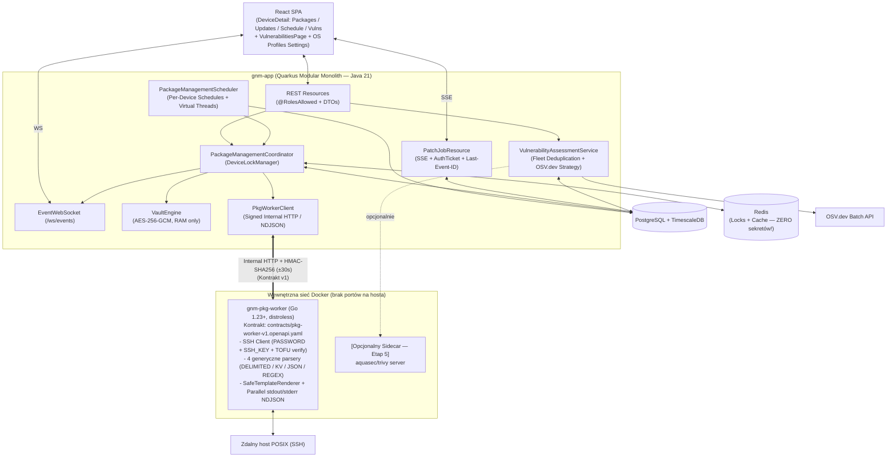

# Architektura modułu zarządzania pakietami i podatnościami (Core + Stateless Go Worker)

**Status:** Zatwierdzone decyzje architektoniczne (ADR-0..9)  
**Powiązany plan implementacji (TDD):** [`plans/package-management-plan.md`](../plans/package-management-plan.md)  
**Materiał wejściowy:** [`docs/ne-updates.md`](ne-updates.md)  
**Zgodność z inwariantami:** [`.agents/invariants.md`](../.agents/invariants.md)

---

## 1. Cel, zakres i podział na kontenery

Celem modułu jest dodanie do **GreatNetworkManager / LanAlmanac** bezagentowego (agentless) systemu dla hostów **POSIX/SSH (Linux, BSD, urządzenia sieciowe/IoT — bez wsparcia dla Windows)**:
1. inwentaryzacji zainstalowanych pakietów (**Inventory**),
2. bezinwazyjnego sprawdzania dostępnych aktualizacji (**Update Check**),
3. kontrolowanego wdrażania aktualizacji ze strumieniowaniem logów na żywo (**Patch Execution** — ręcznie z GUI oraz według harmonogramu per urządzenie),
4. pasywnej analizy podatności po stronie serwera (**Vulnerability Assessment**).

**Nadrzędne zasady architektoniczne:**
1. **Zero hardcodowanej logiki OS w kodzie** (zarówno w `gnm-app`, jak i w `gnm-pkg-worker`) — wsparcie dla nowej dystrybucji Linuksa, BSD czy urządzenia IoT polega wyłącznie na dodaniu/edycji profilu `os_profile` z poziomu UI lub importu JSON (`schemaVersion: 1`).
2. **Wymienialny, bezstanowy kontener wykonawczy `gnm-pkg-worker` (Go 1.23+)** za stabilnym, wersjonowanym kontraktem `contracts/pkg-worker-v1.openapi.yaml` — można go w przyszłości wymienić bez dotykania bazy danych, `VaultEngine`, Auth/RBAC, REST API czy frontendu.
3. **TDD-first:** każdy komponent (Go worker, Quarkus core, API RBAC, kontrakt, UI E2E) powstaje w cyklu **Red → Green → Refactor**.

### Granica odpowiedzialności

| Obszar | `gnm-app` (Core — Quarkus / Java 21) | `gnm-pkg-worker` (Bezstanowy Kontener — Go 1.23+) |
| :--- | :--- | :--- |
| **PostgreSQL / Flyway** | **Wyłączny właściciel** wszystkich tabel i migracji (`V24`–`V28`) | **Brak dostępu do DB** |
| **`VaultEngine` i sekrety** | **Wyłączny właściciel** klucza master i zaszyfrowanych poświadczeń | Otrzymuje sekret wyłącznie w RAM na czas 1 żądania dla hosta z zaufanym TOFU; natychmiast zeruje bufor; zero zapisu na dysk/logi/Redis |
| **TOFU (`sshHostKeyTrusted`)** | Przechowuje stan zaufania, zarządza `trust-ssh`, tworzy `ThreatEvent` | Porównuje fingerprint hosta z `expectedHostKeySha256` **przed** auth; przy niezgodności przerywa z `HOST_KEY_MISMATCH` |
| **Auth / RBAC / UI / SSE / WS** | `@RolesAllowed`, `AuthTicketService`, SSE dla przeglądarki, `/ws/events`, React UI | Brak portów na hoście; wyłącznie sieć wewnętrzna Docker + podpis HMAC-SHA256 |
| **Orkiestracja, locki, harmonogram per device** | `DeviceLockManager`, `OsProfile` CRUD, `ProfileValidator`, `PatchJob` historia, `DevicePackageSchedule` + `PackageManagementScheduler` | Bezstanowy wykonawca pojedynczej operacji (+ mapa aktywnych `executionId` w RAM do `/cancel`) |
| **Transport SSH + Parsery + Egzekucja** | Klient HTTP/NDJSON `PkgWorkerClient` | `golang.org/x/crypto/ssh` (`PASSWORD` + `SSH_KEY`), probe POSIX, 4 generyczne parsery, równoległy odczyt `stdout`/`stderr`, streaming NDJSON |
| **Krok 4 — Podatności (CVE)** | `VulnerabilityAssessmentService` + `OsvApiVulnerabilityProvider` (MVP), za interfejsem `VulnerabilityProvider` | Niezaangażowany (opcjonalnie w Etapie 5 osobny sidecar `aquasec/trivy server`) |

---

## 2. Architektura wysokopoziomowa



---

## 3. Stabilny kontrakt wewnętrzny: `contracts/pkg-worker-v1.openapi.yaml`

Kontrakt jest wspólnym źródłem prawdy dla `gnm-app` i `gnm-pkg-worker`. Każda zmiana implementacji workera jest weryfikowana zestawem **Contract Tests** przeciw kontenerom `ubuntu_ne`, `centos_ne`, `alpine_ne` z [`docker-compose.yml`](../docker-compose.yml).

### 3.1 Bezpieczeństwo kanału Core ↔ Worker
1. **Izolacja sieciowa:** `gnm-pkg-worker` podpięty wyłącznie do wewnętrznej sieci Docker, **bez sekcji `ports:`**.
2. **Podpis HMAC-SHA256 + anty-replay:** każde żądanie zawiera:
   * `X-GNM-Timestamp`: Unix epoch (sekundy), okno ±30 s,
   * `X-GNM-Signature`: `HMAC-SHA256(sharedSecret, method + "\n" + path + "\n" + timestamp + "\n" + sha256(body))` (weryfikacja stałoczasowa; `GNM_PKG_WORKER_AUTH_SECRET` min. 32 losowe bajty, brak domyślnego fallbacku w produkcji).
   * Architektura dopuszcza późniejsze włączenie mTLS przez zmienne środowiskowe bez zmiany kontraktu `v1`.
3. **Polityka TOFU i zerowania sekretów:**
   * `gnm-app` **nigdy** nie wysyła poświadczeń dla hosta z `sshHostKeyTrusted != true`.
   * Pierwsze pobranie odcisku klucza odbywa się przez `POST /v1/ssh/fingerprint` **bez poświadczeń** (wyłącznie handshake KEX).
   * Wszystkie pozostałe endpointy wymagają `target.expectedHostKeySha256`. Worker weryfikuje fingerprint przed próbą logowania (`HOST_KEY_MISMATCH` zwraca `actualFingerprint`).
   * W Go workerze bufor `[]byte` z sekretem (`auth.secret` oraz przyszły `elevationSecret`) jest nadpisywany zerami (`clear(buf)`) natychmiast po uwierzytelnieniu sesji SSH; worker nigdy nie loguje ciał żądań.

### 3.2 Endpointy kontraktu `v1`

| Endpoint | Metoda | Odpowiedź | Przeznaczenie |
| :--- | :--- | :--- | :--- |
| `/v1/health` | `GET` | `application/json` | Status, `contractVersion: "1.0"`, `workerVersion`, `implementation: "go"`, `supportedParsers`, `supportedElevationModes` |
| `/v1/ssh/fingerprint` | `POST` | `application/json` | Pobranie `SHA256:...` klucza hosta SSH **bez poświadczeń** |
| `/v1/probe` | `POST` | `application/json` | Uniwersalny probe POSIX (`uname -s -m -r`, `/etc/os-release`, fallback Alpine/OpenWrt/BSD, opcjonalne `verifyCommands[]`) → `osFacts` |
| `/v1/inventory` | `POST` | `application/json` | Wykonanie `inventorySpec` + strumieniowe parsowanie → `packages[]` (`name`, `version`, `arch`, `sourceName`, `sourceVersion`, `purl`) |
| `/v1/updates/check` | `POST` | `application/json` | Wykonanie `updateCheckSpec` (`refresh` + `check` + `lockSpec` retry + `successExitCodes`) → `updates[]` + `status` |
| `/v1/patch/execute` | `POST` | `application/x-ndjson` *(stream)* | Fazy `PRECHECK` → `REFRESH` → `UPGRADE` → `REBOOT_CHECK` z równoległym strumieniowaniem `stdout`/`stderr` jako ramki NDJSON |
| `/v1/executions/{executionId}/cancel` | `POST` | `application/json` | Anulowanie aktywnego wykonania po `context.CancelFunc` w pamięci workera |

### 3.3 Przygotowanie kontraktu na przyszłe `sudo` z hasłem (ADR-3)
W kontrakcie `v1` pole `privilegeSpec` od pierwszego dnia wspiera jawny enum `elevationMode`:
```json
{
  "privilegeSpec": {
    "elevationMode": "SUDO_NOPASSWD",
    "wrapperTemplate": "sudo -n {{command}}",
    "sudoersAllowedCommands": [
      "/usr/bin/apt-get update -qq",
      "/usr/bin/apt-get -y -o Dpkg::Lock::Timeout=60 -o Dpkg::Options::=--force-confdef -o Dpkg::Options::=--force-confold upgrade"
    ]
  }
}
```
* **W MVP:** obsługiwane wartości to `NONE` (np. konto `root` lub operacje read-only) oraz `SUDO_NOPASSWD` (`sudo -n` + generator gotowego `/etc/sudoers.d/lanalmanac` w UI).
* **Forward-compatibility dla `SUDO_PASSWORD`:** w schemacie `target.auth` rezerwujemy opcjonalne pole `sudoSecret` (z osobną wartością `elevationMode: "SUDO_PASSWORD"` i `passwordWrapperTemplate: "sudo -S -p '' {{command}}"`). Gdy w przyszłości dodamy jego obsługę (Etap 5.5), worker poda `sudoSecret` wyłącznie na `stdin` kanału SSH z natychmiastowym `clear(buf)` (nigdy w argumentach poleceń ani w `echo $PASS | sudo -S`) — **bez łamania kontraktu `v1`**. W MVP próba użycia `SUDO_PASSWORD` zwraca czytelny kod błędu `UNSUPPORTED_ELEVATION_MODE`.

### 3.4 Format strumienia `application/x-ndjson` z `/v1/patch/execute`
```json
{"type":"PHASE","seq":1,"ts":"2026-11-17T21:10:00Z","phase":"REFRESH"}
{"type":"LOG","seq":2,"ts":"2026-11-17T21:10:01Z","stream":"STDOUT","line":"Hit:1 http://deb.debian.org/debian bookworm InRelease"}
{"type":"PHASE","seq":3,"ts":"2026-11-17T21:10:04Z","phase":"UPGRADE"}
{"type":"PHASE","seq":4,"ts":"2026-11-17T21:11:12Z","phase":"REBOOT_CHECK"}
{"type":"RESULT","seq":5,"ts":"2026-11-17T21:11:13Z","status":"SUCCEEDED","exitCode":0,"rebootRequired":true,"errorCode":null,"errorMessage":null}
```

**Katalog kodów błędów (`errorCode`):**
`HOST_KEY_MISMATCH`, `AUTH_FAILED`, `CONNECTION_REFUSED`, `CONNECTION_TIMEOUT`, `CONNECTION_LOST`, `SUDO_PERMISSION_REQUIRED`, `UNSUPPORTED_ELEVATION_MODE`, `PACKAGE_MANAGER_LOCKED`, `COMMAND_TIMEOUT`, `IDLE_TIMEOUT`, `PARSER_ERROR`, `INVALID_PACKAGE_NAME`, `CANCELLED`.

---

## 4. Przepływ 4 kroków Pipeline'u + Harmonogramy per urządzenie

### 4.0 OS Discovery (bez `if/else`)
1. Jeśli `physical_device.os_profile_pinned == true`, użyj przypiętego profilu.
2. Weryfikacja TOFU (`sshHostKeyTrusted == true`); w przeciwnym razie `POST /v1/ssh/fingerprint` (bez poświadczeń) → zapis `sshHostKey` (`sshHostKeyTrusted = false`) → komunikat wymagający zatwierdzenia w UI.
3. `POST /v1/probe` → `osFacts` (`kernel`, `arch`, `running_kernel`, `os.id`, `os.id_like`, `os.version_id`, `os.version_major`, `os.version_major_minor`).
4. `OsProfileMatcher` w `gnm-app` dopasowuje pierwszy aktywny profil (`ORDER BY priority ASC`) wg deklaratywnych reguł JSONB (`EQUALS`, `NOT_EQUALS`, `IN`, `CONTAINS_TOKEN`, `PREFIX`, `REGEX`) i opcjonalnego `verifyCommand`.

### 4.1 Krok 1: Inventory
* `gnm-app` zakłada `DeviceLockManager`, wysyła `POST /v1/inventory` z `inventorySpec` i `osFacts`.
* `gnm-pkg-worker` wykonuje komendę z `LC_ALL=C`, parsuje `stdout` strumieniowo (`bufio.Scanner`, limit 16 MB) jednym z 4 generycznych parserów (`DELIMITED`, `KEY_VALUE_BLOCKS`, `JSON_MAPPING`, `REGEX_LINE`) i zwraca znormalizowane pakiety z `purl`, `sourceName`, `sourceVersion`.
* Profil `debian-apt` zbiera `${Status}\t${Package}\t${Version}\t${Architecture}\t${source:Package}\t${source:Version}` z filtrem `install ok installed`.
* `gnm-app` wykonuje atomowy upsert `device_package`, usuwa odinstalowane pakiety, emituje `InventoryUpdatedEvent` (wyzwala Krok 4) oraz udostępnia eksport **CycloneDX 1.5 JSON** w locie (`GET /api/devices/{id}/sbom`).

### 4.2 Krok 2: Update Check
* `gnm-app` zakłada lock i wysyła `POST /v1/updates/check` z `updateCheckSpec`, `privilegeSpec`, `lockSpec`.
* Worker wykonuje opcjonalny `refreshCommand` (z retry z backoffem przy `lockSpec.lockErrorPattern` — nigdy nie usuwa plików locka) oraz bezinwazyjny `checkCommand` (z obsługą `noUpdatesExitCodes` i `updatesAvailableExitCodes`, np. `100` dla `dnf`).
* `gnm-app` zapisuje `device_available_update` i koreluje `device_vulnerability.fix_available_now`.

### 4.3 Krok 3: Patch Execution (GUI + Schedule per device)
* Uruchamiane ręcznie przyciskiem w GUI (`POST /api/devices/{id}/patch-jobs`) **lub** automatycznie przez `PackageManagementScheduler` z harmonogramu skonfigurowanego per urządzenie.
* **Podwójna ochrona przed Command Injection (`{{packages}}`):**
  1. `gnm-app` waliduje każdą nazwę regexem `^[a-zA-Z0-9][a-zA-Z0-9.+:~_-]{0,127}$` i sprawdza obecność w `device_available_update`.
  2. `gnm-pkg-worker` waliduje ponownie tym samym regexem i stosuje POSIX single-quoting po `--`.
* `gnm-app` zakłada lock, tworzy `patch_job` (`triggered_by = "<username>"` lub `"schedule:<configuredBy>"`), uruchamia wirtualny wątek strumieniujący `POST /v1/patch/execute` i zwraca `202 Accepted`.
* Worker równolegle czyta `stdout` i `stderr` (dwie goroutines + mutex/channel → zero deadlocka!), emituje ramki NDJSON.
* `gnm-app` zapisuje logi batchowo do `patch_job_log` (limit 50 000 linii / 10 MB, retencja 30 dni) i rozsyła je przez `PatchJobLogBroker` do klientów SSE przeglądarki (`GET /api/patch-jobs/{jobId}/stream?ticket=...` z `Last-Event-ID`).
* Przy zerwaniu połączenia SSH bez kodu wyjścia → status `CONNECTION_LOST` i zaplanowany re-check Inventory po 60 s (ADR-4). Po `SUCCEEDED` → aktualizacja `reboot_required`, broadcast na `/ws/events` oraz automatyczne wyzwolenie Kroku 1 (Inventory) → Kroku 4 (CVE).

### 4.4 Krok 4: Vulnerability Assessment (Offline w `gnm-app`)
* `OsvApiVulnerabilityProvider` (MVP, ADR-1): deduplikuje `(ecosystem, queryName, queryVersion)` w całej flocie (z użyciem `source_name` dla Debiana/Ubuntu), odpytuje wsadowo `POST https://api.osv.dev/v1/querybatch` (paczki po 500), cache'uje szczegóły w `vulnerability_advisory`, zachowuje statusy `ACCEPTED_RISK`/`FALSE_POSITIVE`, koreluje `fix_available_now` i wysyła alerty `CRITICAL`/`HIGH` na `/ws/events`.
* Interfejs `VulnerabilityProvider` umożliwia dodanie `TrivyServerVulnerabilityProvider` w Etapie 5 bez zmian w reszcie systemu.

### 4.5 Harmonogramy per urządzenie (`device_package_schedule` — ADR-5)
Każde urządzenie może mieć niezależnie skonfigurowany z GUI harmonogram dla każdego typu zadania:
* **Inventory Schedule** (`inventory_enabled`, `inventory_cron`, domyślnie wyłączony lub dziedziczy domyślny preset, np. `0 3 * * *`)
* **Update Check Schedule** (`update_check_enabled`, `update_check_cron`)
* **Auto-Patch Schedule** (`auto_patch_enabled` — **zawsze domyślnie `false`**, opt-in per urządzenie!, `auto_patch_cron`, `auto_patch_mode`: `SECURITY_ONLY` | `FULL_UPGRADE`)
* Wspólne pole `timezone` (domyślnie `UTC`, walidowane przez `ZoneId.of`), pola `next_*_run_at`, `last_*_run_at` oraz audytowe `updated_by`, `updated_at`.
* **Zasady bezpieczeństwa harmonogramu:**
  * Ticker `@Scheduled(every = "60s")` w `PackageManagementScheduler` pobiera wyłącznie urządzenia, których `next_*_run_at <= now()`, status != `OFFLINE`, `sshHostKeyTrusted == true` oraz `VaultEngine.isUnsealed() == true`.
  * Limit równoległych połączeń SSH (`gnm.pkg.scheduler.max-concurrent-hosts`, domyślnie `5`) wymuszony semaforem na wirtualnych wątkach (`Semaphore`).
  * Gdy lock urządzenia jest zajęty (np. trwa ręczny patch), zaplanowany job jest pomijany z zapisem `SKIPPED_LOCKED` (bez kolejkowania duplikatów) i przeliczany na kolejne okno `next_*_run_at`.
  * W GUI obok zaawansowanego pola cron dostępne są proste presety (np. *Daily at HH:MM*, *Weekly on Sunday at 03:00*, *Custom cron*) z podglądem 3 najbliższych dat uruchomienia wyliczonych po stronie backendu.

### 4.6 Wybór poświadczenia SSH — wielokategoriowe `Credential` i `CredentialResolver` (ADR-9)
Zamiast zgadywania pierwszego poświadczenia na urządzeniu (`device.credentials.findFirst()`), encja `Credential` otrzymuje zbiór kategorii/ról (`credential_category`, analogicznie do `physical_device_labels`):
* Jedno poświadczenie może mieć **wiele kategorii** jednocześnie (np. `["SSH_TERMINAL", "PKG_MANAGEMENT"]` — zero duplikowania kluczy w Vault).
* Przykładowy słownik kategorii (`CredentialCategory`): `PKG_MANAGEMENT`, `PKG_MANAGEMENT_FALLBACK`, `SSH_TERMINAL`, `WEB_ADMIN`, `MONITORING`, `API`, `GENERAL`.
* **Determinizm (brak losowania):** role wykonawcze `PKG_MANAGEMENT` i `PKG_MANAGEMENT_FALLBACK` są **unikalne w obrębie jednego urządzenia** (maks. 1 poświadczenie `PKG_MANAGEMENT` i maks. 1 `PKG_MANAGEMENT_FALLBACK` per `physical_device_id`, wymuszone przez walidację + bazę danych; przypisanie roli do nowego klucza w UI pozwala ją atomowo przenieść podczas rotacji). Kategorie informacyjne (`SSH_TERMINAL`, `WEB_ADMIN`, `MONITORING` itp.) mogą występować na wielu poświadczeniach.
* **Kolejność rozwiązywania w `CredentialResolver` (wyłącznie typy `SSH_KEY` i `PASSWORD`):**
  1. Poświadczenie z kategorią `PKG_MANAGEMENT`.
  2. Poświadczenie z kategorią `PKG_MANAGEMENT_FALLBACK`:
     * jako **fallback konfiguracyjny**, gdy na urządzeniu nie ma żadnego poświadczenia `PKG_MANAGEMENT`, **lub**
     * jako **jednorazowy fallback uwierzytelniania** (maks. 1 dodatkowa próba → łącznie max 2 próby logowania, bezpieczne względem `fail2ban`), wyłącznie gdy `PKG_MANAGEMENT` zakończyło się błędem `AUTH_FAILED` (z zapisem ostrzeżenia w logach i audycie).
     * **Twarda zasada bezpieczeństwa:** **nigdy** nie wykonuje się fallbacku przy `HOST_KEY_MISMATCH` (możliwy MITM!).
  3. Ostatni fallback konfiguracyjny: `NetworkService(SSH).credential` (dla prostych hostów z jednym kluczem SSH przypiętym do usługi SSH, bez konieczności ręcznego tagowania).
  4. Brak kandydata → status `MISSING_CREDENTIAL` (scheduler pomija hosta, UI pokazuje komunikat wskazujący dodanie kategorii `PKG_MANAGEMENT` lub podpięcie credentiala do usługi SSH).
* **Audyt i przejrzystość:** UI na zakładce urządzenia wyświetla aktywnie rozwiązane poświadczenie i źródło wyboru (np. `lanalmanac [PKG_MANAGEMENT]` lub `ubuntu [SSH service fallback]`), generator `sudoers.d` podstawia jego `username`, a każdy `patch_job` zapisuje `credential_id`, `credential_username` oraz flagę `used_fallback`.

---

## 5. Schemat bazy danych (wyłącznie w `gnm-app` — Flyway `V24`–`V28`)

1. **`V24__os_profiles.sql`** — `os_profile` + kolumny `os_profile_id`, `os_profile_pinned`, `os_facts`, `os_detected_at` na `physical_device` + tabela `credential_category (credential_id, physical_device_id, category)` z unikalnością ról wykonawczych (`PKG_MANAGEMENT`, `PKG_MANAGEMENT_FALLBACK`) per urządzenie + seed 3 profili systemowych (`debian-apt`, `rhel-dnf`, `alpine-apk`).
2. **`V25__device_packages_and_vulnerabilities.sql`** — `device_package_scan`, `device_package`, `vulnerability_advisory`, `device_vulnerability`.
3. **`V26__device_available_updates.sql`** — `device_available_update` + kolumny `updates_last_checked_at`, `reboot_required` na `physical_device`.
4. **`V27__patch_jobs.sql`** — `patch_job` (w tym `credential_id`, `credential_username`, `used_fallback`), `patch_job_log`.
5. **`V28__device_package_schedule.sql`** — `device_package_schedule` (`physical_device_id PK/FK`, flagi `*_enabled`, wyrażenia `*_cron`, `auto_patch_mode`, `timezone`, kolumny `next_*_run_at` z indeksem częściowym `WHERE ..._enabled = TRUE`, `last_*_run_at`, `updated_by`, `updated_at`).

---

## 6. Kontrakty REST API (zewnętrzne, `gnm-app`) i Macierz Uprawnień

Wszystkie zasoby używają wyłącznie DTO (Inwariant #4) i jawnych `@RolesAllowed` (Inwariant #6, #7):

| Endpoint | Metoda | Role (`@RolesAllowed`) | Opis |
| :--- | :--- | :--- | :--- |
| `/api/os-profiles` | `GET` | `gnm-admin`, `gnm-operator`, `gnm-viewer` | Lista profili OS + status/wersja `gnm-pkg-worker` |
| `/api/os-profiles/{id}` | `GET` | `gnm-admin`, `gnm-operator`, `gnm-viewer` | Szczegóły profilu + generator `/etc/sudoers.d/lanalmanac` |
| `/api/os-profiles` / `/{id}` | `POST` / `PUT` / `DELETE` | `gnm-admin` | CRUD customowych profili (`is_system=true` → `409 Conflict`) |
| `/api/os-profiles/{id}/clone` | `POST` | `gnm-admin` | Klonowanie profilu systemowego |
| `/api/os-profiles/import` | `POST` | `gnm-admin` | Import profilu JSON (`schemaVersion: 1`) z walidacją |
| `/api/os-profiles/{id}/export` | `GET` | `gnm-admin`, `gnm-operator`, `gnm-viewer` | Eksport profilu JSON (`schemaVersion: 1`) |
| `/api/os-profiles/test` | `POST` | `gnm-admin` | Dry-run (wyłącznie read-only: probe + inventory parse preview) |
| `/api/devices/{id}/os-profile` | `PUT` | `gnm-admin`, `gnm-operator` | Przypięcie/odpięcie profilu OS na urządzeniu |
| `/api/devices/{id}/os-profile/detect` | `POST` | `gnm-admin`, `gnm-operator` | Wymuszenie auto-detekcji OS |
| `/api/devices/{id}/packages` | `GET` | `gnm-admin`, `gnm-operator`, `gnm-viewer` | Paginowana lista pakietów |
| `/api/devices/{id}/packages/scan` | `POST` | `gnm-admin`, `gnm-operator` | Ręczne uruchomienie Kroku 1 (Inventory) → `202` |
| `/api/devices/{id}/sbom` | `GET` | `gnm-admin`, `gnm-operator`, `gnm-viewer` | Eksport CycloneDX 1.5 JSON |
| `/api/devices/{id}/updates` | `GET` | `gnm-admin`, `gnm-operator`, `gnm-viewer` | Lista dostępnych aktualizacji |
| `/api/devices/{id}/updates/check` | `POST` | `gnm-admin`, `gnm-operator` | Ręczne uruchomienie Kroku 2 (Update Check) → `202` |
| `/api/devices/{id}/patch-jobs` | `POST` | `gnm-admin`, `gnm-operator` | Ręczne uruchomienie Kroku 3 (Patch Execution) → `202` + `jobId` |
| `/api/devices/{id}/patch-jobs` | `GET` | `gnm-admin`, `gnm-operator`, `gnm-viewer` | Historia zadań patchowania |
| `/api/patch-jobs/{jobId}` | `GET` | `gnm-admin`, `gnm-operator`, `gnm-viewer` | Status zadania + paginowane logi |
| `/api/patch-jobs/{jobId}/stream?ticket=...` | `GET` (SSE) | `gnm-admin`, `gnm-operator` *(via `AuthTicket`)* | Stream logów na żywo + replay od `Last-Event-ID` |
| `/api/patch-jobs/{jobId}/cancel` | `POST` | `gnm-admin`, `gnm-operator` | Anulowanie aktywnego zadania |
| `/api/devices/{id}/package-schedule` | `GET` | `gnm-admin`, `gnm-operator`, `gnm-viewer` | Pobranie harmonogramu urządzenia + podgląd `nextRunAt` |
| `/api/devices/{id}/package-schedule` | `PUT` | `gnm-admin`, `gnm-operator` | Zapis/aktualizacja harmonogramu per urządzenie (walidacja cron + timezone) |
| `/api/devices/{id}/vulnerabilities` | `GET` | `gnm-admin`, `gnm-operator`, `gnm-viewer` | Podatności urządzenia |
| `/api/devices/{id}/vulnerabilities/scan` | `POST` | `gnm-admin`, `gnm-operator` | Ręczne odświeżenie Kroku 4 dla urządzenia |
| `/api/vulnerabilities` | `GET` | `gnm-admin`, `gnm-operator`, `gnm-viewer` | Globalny dashboard CVE sieci |
| `/api/vulnerabilities/{vulnId}/status` | `PATCH` | `gnm-admin`, `gnm-operator` | Zmiana statusu (`OPEN` / `ACCEPTED_RISK` / `FALSE_POSITIVE`) |

---

## 7. Integracja z Frontendem (React + Tailwind 4 + Shadcn/ui + Zustand)

Wszystkie etykiety i komunikaty UI wyłącznie po angielsku (Inwariant #5). Wydzielone komponenty (nie powiększamy `DeviceDetail.tsx`):
* `frontend/src/components/packages/DevicePackagesTab.tsx` — profil OS (pin/detect), podgląd rozwiązanego poświadczenia (`Effective credential` + źródło/fallback), lista pakietów, przycisk `Scan Inventory`, `Download SBOM`.
* Rozszerzenie formularza i listy poświadczeń (`DeviceDetail.tsx` / Vault credentials) o wielokrotny wybór kategorii (`PKG_MANAGEMENT`, `PKG_MANAGEMENT_FALLBACK`, `SSH_TERMINAL`, `WEB_ADMIN`, `MONITORING`, `API`, `GENERAL`) z wyświetlaniem badge'y.
* `frontend/src/components/packages/DeviceUpdatesTab.tsx` — aktualizacje + powiązane CVE, przyciski `Check Updates`, `Upgrade All`, `Upgrade Selected`, baner `Reboot Required`, modal `sudoers.d`, historia `PatchJob`.
* `frontend/src/components/packages/PatchJobLogModal.tsx` — live log viewer SSE z reconnectem po `Last-Event-ID`.
* `frontend/src/components/packages/DeviceScheduleCard.tsx` — konfiguracja harmonogramów per urządzenie (Inventory / Update Check / Auto-Patch z wyraźnym ostrzeżeniem i wyborem trybu `Security Only` vs `Full Upgrade`, presety + custom cron, timezone, podgląd najbliższych 3 uruchomień).
* `frontend/src/components/packages/DeviceVulnerabilitiesTab.tsx` — lista CVE, severity badges, `Accept Risk` / `False Positive`.
* `frontend/src/pages/VulnerabilitiesPage.tsx` — globalny przegląd podatności sieci (`/vulnerabilities`).
* `frontend/src/pages/OsProfilesSettingsTab.tsx` — CRUD customowych profili (`gnm-admin`), import/eksport JSON (`schemaVersion: 1`), `Test Profile (Dry-Run)`, status zdrowia `gnm-pkg-worker`.

---

## 8. Rejestr podjętych decyzji architektonicznych (ADR)

| ADR | Temat | Decyzja | Uwagi / Konsekwencje |
| :--- | :--- | :--- | :--- |
| **ADR-0** | Język `gnm-pkg-worker` | **ZATWIERDZONE: Go (1.23+)** | Statyczna binarka w obrazie `distroless`, `golang.org/x/crypto/ssh`, natywne goroutines i streaming NDJSON, brak narzutu JVM. |
| **ADR-1** | Silnik CVE (Krok 4) | **ZATWIERDZONE: Opcja A (OSV.dev API w MVP)** | Zero nowych zależności w MVP; czysty interfejs `VulnerabilityProvider` gotowy pod opcjonalny sidecar `aquasec/trivy server` w Etapie 5. |
| **ADR-2** | Wsparcie Windows | **ZATWIERDZONE: Brak wsparcia Windows** | Wyłącznie hosty POSIX przez SSH (Linux, BSD, IoT). Zero kodu WinRM i brak profili Windows/PowerShell. |
| **ADR-3** | Uprawnienia `sudo` | **ZATWIERDZONE: MVP `sudo -n` (`NOPASSWD`), przygotowane pod przyszłe `sudo -S`** | Kontrakt `v1` od razu ma enum `elevationMode` (`NONE`, `SUDO_NOPASSWD`, `SUDO_PASSWORD`) i opcjonalny `sudoSecret`; w MVP `SUDO_PASSWORD` zwraca `UNSUPPORTED_ELEVATION_MODE`, a implementacja przez `stdin` trafi do Etapu 5.5 bez łamania kontraktu. |
| **ADR-4** | Utrata sesji SSH przy patchu | **ZATWIERDZONE: Opcja A** | Wykrycie nagłego EOF bez kodu wyjścia jako `CONNECTION_LOST` + automatyczny re-check Inventory po 60 s. |
| **ADR-5** | Uruchamianie i harmonogramy | **ZATWIERDZONE: Ręcznie z GUI + Schedule per urządzenie z GUI** | Dedykowana tabela `device_package_schedule` (V28), osobne harmonogramy dla Inventory, Update Check i opt-in Auto-Patch (`SECURITY_ONLY`/`FULL_UPGRADE`), konfiguracja i podgląd kolejnych uruchomień w GUI. |
| **ADR-6** | Relacja do `hardening-plan.md` | **Domyślnie: Nowy kod utwardzony od dnia 1; hardening Etap 1–2 przed produkcją** | Wszystkie nowe zasoby powstają od razu z `@RolesAllowed`, DTO i `AuthTicket`. |
| **ADR-7** | Import/eksport profili OS | **ZATWIERDZONE: Opcja A (`schemaVersion: 1`)** | Wersjonowany JSON do importu/eksportu profili w UI i dzielenia się nimi w społeczności. |
| **ADR-8** | Kanał Core ↔ Worker | **ZATWIERDZONE: Opcja A (Internal Docker net + HMAC-SHA256 ±30s)** | Zero ekspozycji portów workera; opcjonalne mTLS możliwe do włączenia później bez zmiany kontraktu. |
| **ADR-9** | Wybór poświadczenia SSH | **ZATWIERDZONE: Wielokategoriowe `Credential` + `CredentialResolver`** | Tabela `credential_category` (wiele kategorii per klucz, np. `PKG_MANAGEMENT`, `PKG_MANAGEMENT_FALLBACK`, `SSH_TERMINAL`); role `PKG_MANAGEMENT` / `PKG_MANAGEMENT_FALLBACK` unikalne per urządzenie; kaskada `PKG_MANAGEMENT` → `PKG_MANAGEMENT_FALLBACK` (max 1 próba przy `AUTH_FAILED`, nigdy przy `HOST_KEY_MISMATCH`) → `NetworkService(SSH).credential`; pełny audyt `credential_id` + `used_fallback` na `patch_job`. |
