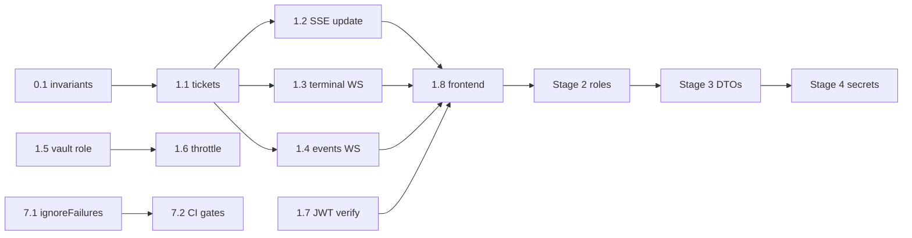

# GreatNetworkManager / LanAlmanac Security & Quality Hardening Plan

Executed in small, self-contained steps. Each step is independently deployable and verifiable.
The order of stages is intentional: first close unauthenticated access, then build quality gates,
and finally optimize performance and code hygiene.

Size Legend (file count and risk, not duration):
- **S** — 1–2 files, local change, low risk
- **M** — 3–5 files, requires a test
- **L** — more than 5 files or an API contract change

---

## Stage 0 — Agent Knowledge Base

- [x] **0.1** Create [`.agents/invariants.md`](../.agents/invariants.md) (hard rules, <100 lines) — **S**
- [x] **0.2** Create [`.agents/context-map.md`](../.agents/context-map.md) (file map with line numbers and "what not to read") — **S**
- [x] **0.3** Create single-step brief template `plans/_brief-template.md` — **S**
- [x] **0.4** Add "Definition of Done" and links to the above in [`.agents/AGENTS.md`](../.agents/AGENTS.md) — **S**

**Criterion:** An agent can answer questions about any module by reading at most 2 files in `.agents/`.

---

## Stage 1 — Access Closure (P0, Highest Risk)

Current state: [`application.properties`](../gnm-app/src/main/resources/application.properties:35) exposes the vault, SSH terminal, SSE update stream, events WebSocket, and change-password endpoints without authentication.

### 1.1 [x] Single-Use Tickets for SSE and WebSocket — **M**
**Goal:** A mechanism that closes three streaming/WS endpoints without breaking the frontend (`EventSource` and `WebSocket` cannot send custom `Authorization` headers).

**Files:**
- new `gnm-app/src/main/java/com/gnm/auth/AuthTicketService.java`
- new `gnm-app/src/main/java/com/gnm/resource/AuthTicketResource.java`
- new `gnm-app/src/main/java/com/gnm/dto/AuthTicket.java`

**Changes:**
- `POST /api/auth/ticket` (authenticated, role `gnm-admin` or `gnm-operator`) accepts `{ "purpose": "sse-update" | "sse-patch-job" | "ws-terminal" | "ws-events", "resourceId": "<uuid|null>" }`
- returns `{ "ticket": "<random 32B base64url>", "expiresAt": "<iso>" }`
- ticket stored in memory: `Map<String, Ticket>`, 30s TTL, single-use
- ticket contains: `username`, `roles`, `purpose`, `resourceId`, `expiry`
- `consume(ticket, purpose, resourceId)` — atomically removes and validates (`ConcurrentHashMap.remove`), returning `Optional<Ticket>`
- expired ticket cleanup: `@Scheduled(every = "60s")`

**Criterion:** Unit test covers: valid consumption, replay rejection, wrong `purpose`, expiration, mismatched `resourceId`.

**Verification:** `./gradlew :gnm-app:test --tests "*AuthTicketServiceTest"`

### 1.2 [x] SSE `/api/devices/{id}/update` — **M**
**Files:** [`UpdateResource.java`](../gnm-app/src/main/java/com/gnm/resource/UpdateResource.java:36), [`application.properties`](../gnm-app/src/main/resources/application.properties:35), [`DeviceDetail.tsx`](../frontend/src/pages/DeviceDetail.tsx:1622)

**Changes:**
- keep `GET /api/devices/{id}/update?ticket=...` (browser `EventSource` supports only `GET`, and the single-use 32B ticket issued by authenticated `POST /api/auth/ticket` acts as an anti-CSRF token)
- `@RolesAllowed({"gnm-admin", "gnm-operator"})` on `UpdateResource`
- validate `consume(ticket, "sse-update", id)` (including ticket authentication mechanism for SSE requests without an `Authorization` header); missing/invalid → `401` before starting SSH or querying the database
- remove `/api/devices/*/update` from `permission.public.paths`
- replace `ManagedExecutor` with virtual threads (`Thread.startVirtualThread`) per Invariant #2
- enforce SSH host key verification (`ServerKeyVerifier` / `sshHostKeyTrusted`, Invariant #8) and zeroize decrypted secret `byte[]` after use (Invariant #10)
- 15-minute SSE session timeout and stream closure
- frontend (`DeviceDetail.tsx`): request ticket via `POST /api/auth/ticket` (`purpose: "sse-update"`, `resourceId: device.id`) and pass `?ticket=...` to `EventSource` (Invariant #14)

**Criterion:** Request without a ticket returns 401 and performs no SSH connection; request with a valid ticket works as expected and rejects untrusted SSH host keys.

**Verification:** `./gradlew :gnm-app:test --tests "*UpdateResourceTest"`

### 1.3 Terminal WebSocket — **M**
**Files:** [`TerminalWebSocket.java`](../gnm-app/src/main/java/com/gnm/resource/TerminalWebSocket.java:37), [`Terminal.tsx`](../frontend/src/components/Terminal.tsx:74)

**Changes:**
- path `/ws/terminal/{deviceId}/{credentialId}?ticket=...`
- `@OnOpen` reads `ticket` from `connection.handshakeRequest().query()` and calls `consume(ticket, "ws-terminal", deviceId)`
- missing/invalid ticket → `connection.close()` before any database or vault access
- remove `/ws/terminal/*` from `permission.public.paths`
- frontend: fetch ticket via `apiClient` and append to WS URL

**Criterion:** Unauthenticated handshake is rejected; unauthenticated user causes no database writes (`NetworkService` is not created).

**Verification:** `./gradlew :gnm-app:test --tests "*RemoteAccessTest"` + `npx playwright test`

### 1.4 WebSocket `/ws/events` — **S**
**Files:** [`EventWebSocket.java`](../gnm-app/src/main/java/com/gnm/resource/EventWebSocket.java:13), [`Layout.tsx`](../frontend/src/components/Layout.tsx)

**Changes:** Same ticket handshake as 1.3 with `purpose = "ws-events"`; remove `/ws/events` from `permit`; broadcast only to authenticated sessions.

**Criterion:** Missing ticket = no subscription; events do not leak to anonymous clients (device names, IPs, alerts).

### 1.5 Vault — Remove `@PermitAll` — **S**
**Files:** [`VaultResource.java`](../gnm-app/src/main/java/com/gnm/resource/VaultResource.java:16), [`application.properties`](../gnm-app/src/main/resources/application.properties:35)

**Changes:**
- remove `@PermitAll` and `/api/vault/*` from `permit`
- `@RolesAllowed("gnm-admin")` on the class
- **remove fallback** `vaultPassword.orElse(null)` — passcode strictly from request body; delete `gnm.vault.password` config property
- protect `initialize` and `unseal` via brute-force attempt throttling (see 1.6)

**Criterion:** `curl -X POST /api/vault/unseal` without a token → 401. Vault cannot be unsealed using a configuration property fallback.

### 1.6 Rate Limiting & Account Lockout — **M**
**Files:** new `gnm-app/src/main/java/com/gnm/auth/LoginThrottle.java`, [`LocalAuthResource.java`](../gnm-app/src/main/java/com/gnm/resource/LocalAuthResource.java:50), [`VaultResource.java`](../gnm-app/src/main/java/com/gnm/resource/VaultResource.java:60)

**Changes:**
- failed attempt counter per `username` and per IP: threshold 5, 15-minute window, 15-minute lockout
- on `/api/vault/unseal`: threshold 3, 5-minute lockout (Argon2id already slows down guesses, but the counter protects CPU)
- keep identical response messages for unknown user and wrong password
- normalize response timing for non-existent users (dummy Argon2 verify) to prevent account enumeration

**Criterion:** 6th login attempt returns 429; test verifies that response time for a non-existent user is in the same order of magnitude.

### 1.7 `change-password` Without Manual JWT Decoding & Hardening `DynamicOidcTenantResolver` — **M**
**Files:** [`LocalAuthResource.java`](../gnm-app/src/main/java/com/gnm/resource/LocalAuthResource.java:88), [`DynamicOidcTenantResolver.java`](../gnm-app/src/main/java/com/gnm/auth/DynamicOidcTenantResolver.java:14)

**Changes:**
- remove `extractUsernameFromToken()` (manual Base64 + `ObjectMapper` without signature verification)
- inject `JsonWebToken` and read `getSubject()`/`getName()`
- remove `/api/auth/change-password` from public paths — require authentication
- include `jti` and `aud` claims on generated tokens, configurable TTL instead of hardcoded 24h
- invalidate previous sessions after password change (`tokenVersion` field on `GnmUser`, verified in filter)
- in `DynamicOidcTenantResolver`: cache OIDC configuration in memory (invalidated on setting update) instead of running a DB transaction on every HTTP request; validate `oidc.authority.url` (require `https://`, block loopback/link-local/private addresses against SSRF)

**Criterion:** A token with a tampered payload (invalid signature) cannot change a password; invalid/internal OIDC URLs are rejected.

### 1.8 Frontend: Stop Setting JWT Cookie from JavaScript — **M**
**Files:** [`auth-context.tsx`](../frontend/src/lib/auth/auth-context.tsx:112), [`BackupSettingsTab.tsx`](../frontend/src/pages/BackupSettingsTab.tsx:13), [`application.properties`](../gnm-app/src/main/resources/application.properties:29)

**Changes:**
- remove all `document.cookie = \`jwt=...\`` assignments (4 places)
- remove `smallrye.jwt.token.cookie=jwt` from `application.properties` (backend accepts JWT strictly from the `Authorization` header)
- store token in memory + `sessionStorage` instead of `localStorage` (reduced XSS exposure), updating direct references in `BackupSettingsTab.tsx`
- add CSP with `frame-ancestors 'none'` in Quarkus HTTP headers

**Criterion:** No `jwt` cookie in browser devtools; terminal and update streams work properly.

**Verification:** `cd frontend && npm run build && npx playwright test`

---

## Stage 2 — Roles & Permissions — **M**

**Files:** all resources in `gnm-app/src/main/java/com/gnm/resource/`, new `gnm-app/src/main/java/com/gnm/auth/Permissions.java`

**Changes:** Explicit `@RolesAllowed` on every resource class (and on methods for mixed-role resources: `DeviceResource`, `ThreatResource`, `CredentialResource`, `SettingsResource`) according to the matrix:

| Resource / Operation | viewer | operator | admin |
|:---|:---|:---|:---|
| devices GET, telemetry GET, topology GET, threats GET | yes | yes | yes |
| devices mutations (update, state, labels, services CRUD, manual, discover, probe-update) | no | yes | yes |
| devices trust-ssh-key (`PUT /{id}/services/{serviceId}/trust-ssh-key`) | no | yes | yes |
| threats resolve/note | no | yes | yes |
| scanner POST | no | yes | yes |
| discovery toggle/trigger | no | yes | yes |
| credentials list | no | yes | yes |
| credentials reveal | no | no | yes |
| credentials create/update/delete | no | yes | yes |
| users | no | no | yes |
| settings (except `GET /api/settings/public/oidc`) | no | no | yes |
| vault | no | no | yes |
| backup | no | no | yes |
| diagnostics | no | no | yes |
| update (SSE) | no | yes | yes |

Additionally: default `deny` rule — every new resource without an annotation must be rejected, enforced by an ArchUnit test (Stage 8).

**Criterion:** Integration test for every role: `gnm-viewer` receives 403 on all mutating endpoints.

---

## Stage 3 — Mass Assignment & Entity Leakage Prevention — **M**

- [ ] **3.1** Input DTO for `NetworkService` (excluding `sshHostKey` and `sshHostKeyTrusted`) — [`DeviceResource.java`](../gnm-app/src/main/java/com/gnm/resource/DeviceResource.java:141) — **S**
- [ ] **3.2** Input DTO for `GlobalSetting` (only `value`; `key` from path) — [`SettingsResource.java`](../gnm-app/src/main/java/com/gnm/resource/SettingsResource.java:31) — **S**
- [ ] **3.3** `@JsonIgnore` on `encryptedPayload`/`noncePayload` in [`Credential.java`](../gnm-app/src/main/java/com/gnm/model/Credential.java:30) — **S**
- [ ] **3.4** REST responses strictly via DTOs for `PhysicalDevice` — **M**
- [ ] **3.5** Regression test: `PUT /services/{id}` with `sshHostKeyTrusted: true` leaves field unchanged — **S**

**Criterion:** No REST endpoint accepts a JPA entity as a request body.

---

## Stage 4 — Secrets & Cryptography — **M**

- [ ] **4.1** Remove [`privateKey.pem`](../gnm-app/src/main/resources/privateKey.pem:1) from `resources` — **S**
- [ ] **4.2** Fail-fast: application refuses to start if `GNM_AUTH_LOCAL_PASSWORD` or DB password uses default value in `prod` profile — **S**
- [ ] **4.3** Remove `gnm.auth.local.password=admin` and `gnmpassword` from [`application.properties`](../gnm-app/src/main/resources/application.properties:8) — **S**
- [ ] **4.4** [`VaultEngine`](../gnm-app/src/main/java/com/gnm/service/VaultEngine.java:31): zeroize `kekBytes`, `masterKeyBytes`, `synchronized` on `initialize`/`unseal`/`lock`, vault file permissions `0600`, directory `0700` — **M**
- [ ] **4.5** Inactivity auto-lock (`gnm.vault.auto-lock-minutes`) + key wipe on `ShutdownEvent` — **M**
- [ ] **4.6** `vault_audit_log` table: `username`, `action`, `credential_id`, `success`, `at`, `source_ip`; recorded on every reveal/encrypt/decrypt — **M**
- [ ] **4.7** Rotate Sonar token present in `.env` — **S** (external action)

**Criterion:** Test verifies that after `lockVault()`, the master key cannot be accessed and the vault file has `0600` permissions.

---

## Stage 5 — Backup & JNDI — **M**

- [ ] **5.1** Backup password in request body (`POST /api/backup/download`) instead of query string — [`BackupResource.java`](../gnm-app/src/main/java/com/gnm/resource/BackupResource.java:30), [`BackupSettingsTab.tsx`](../frontend/src/pages/BackupSettingsTab.tsx:22) — **S**
- [ ] **5.2** Remove `System.exit(0)` and `new Thread` from restore; use restart event and virtual thread — **M**
- [ ] **5.3** `pg_dump`/`psql` and backup crypto: no silent dummy dump, error propagation, timeout, password via `PGPASSFILE` instead of `PGPASSWORD` env var, `kekBytes` zeroization (`char[]` for password), and deletion of unverified output file on `AEADBadTagException` — [`BackupService.java`](../gnm-app/src/main/java/com/gnm/service/BackupService.java:348) — **M**
- [ ] **5.4** Upload size limit and restore timeout — **S**
- [ ] **5.5** Disable `quarkus.naming.enable-jndi` and rewrite DNS probes using `InetAddress`/dnsjava — **M**

---

## Stage 6 — Containers — **M**

- [ ] **6.1** [`Dockerfile`](../Dockerfile:39): non-root user, `chmod 700` on `/app/keys`, `HEALTHCHECK`, multi-arch pinning — **S**
- [ ] **6.2** [`docker-compose.prod.yml`](../docker-compose.prod.yml:1): remove host port publication for `5432` and `6379`, `no-new-privileges`, `read_only` + tmpfs, Redis password, minimal `cap_add` — **M**
- [ ] **6.3** Pin container images by digest instead of `latest` — **S**
- [ ] **6.4** Provide secrets via files/Docker secrets instead of env vars where supported — **M**

---

## Stage 7 — Quality Gates — **M**

> **Ordering Note:** Step **7.1** should be executed right after Stage 1 so that new tests in Stages 2–6 immediately block regressions.

- [ ] **7.1** `ignoreFailures = true` → `false` in [`build.gradle.kts`](../gnm-app/build.gradle.kts:77); first mark known broken tests `@Disabled` with an issue reference, then fix them sequentially — **S**
- [ ] **7.2** CI: remove `continue-on-error` from test steps, keeping it only on Sonar until the quality gate passes — **S**
- [ ] **7.3** Sonar: add `sonar.java.binaries`, include backend in `sonar.sources`, set `sonar.qualitygate.wait=true` — **S**
- [ ] **7.4** Security CI workflow: gitleaks, Trivy (container image), `npm audit --audit-level=high`, CodeQL — **M**
- [ ] **7.5** Dependabot/Renovate for Gradle and npm — **S**

---

## Stage 8 — Static Analysis & Testing — **M**

- [ ] **8.1** PMD + Checkstyle with an active ruleset — **M**
- [ ] **8.2** Spotless: enable `googleJavaFormat` in addition to `removeUnusedImports` — **S**
- [ ] **8.3** Frontend: `no-explicit-any` → `error`, Prettier, `eslint-plugin-jsx-a11y`, Vitest — **M**
- [ ] **8.4** ArchUnit: module boundaries, every resource has a security annotation, no `@PermitAll` outside the allowlist — **M**
- [ ] **8.5** PIT mutation testing on `VaultEngine` and `PasswordService`, jqwik property tests on `SubnetFilter` and `SimilarityEngine` — **M**

---

## Stage 9 — Performance & Schema — **M**

- [ ] **9.1** Split `join fetch` in [`getAllDevices()`](../gnm-app/src/main/java/com/gnm/resource/DeviceResource.java:50) into separate queries or `@BatchSize` — **S**
- [ ] **9.2** Pagination on `GET /api/devices` (`?page=&size=`, max 200) — **M**
- [ ] **9.3** Telemetry: require time range + point limit, forbid unbounded history — [`TelemetryResource.java`](../gnm-app/src/main/java/com/gnm/resource/TelemetryResource.java:18) — **S**
- [ ] **9.4** Flyway migration adding indexes on `credential(physical_device_id)`, `network_identity(mac_address)`, `threat_event(resolved, detected_at)`, `network_service(physical_device_id)` — **S**
- [ ] **9.5** `ThreatResource.getThreats()` — remove database mutation from `GET` — **S**
- [ ] **9.6** [`FingerprintEngine.java`](../gnm-app/src/main/java/com/gnm/fingerprint/FingerprintEngine.java:81) — replace `ThreadPoolExecutor`, `newScheduledThreadPool`, and `new Thread` with virtual threads (Invariant #2) — **M**

---

## Stage 10 — Frontend Hardening — **M**

- [ ] **10.1** Route-level React Error Boundary — **S**
- [ ] **10.2** Disable OSC 52 in xterm (prevent clipboard exfiltration by remote shells) — **S**
- [ ] **10.3** Runtime API response validation (Zod) at the client boundary — **M**
- [ ] **10.4** CSP, `X-Content-Type-Options`, `Referrer-Policy` headers — **S**

---

## Stage 11 — Observability — **M**

- [ ] **11.1** `quarkus-smallrye-health`: readiness (DB, Redis) and liveness checks — **S**
- [ ] **11.2** Micrometer/Prometheus + sighting queue and probe duration metrics — **M**
- [ ] **11.3** Structured JSON logs, `requestId` correlation, automated test forbidding secret logging — **M**

---

## Stage 12 — Agent Workflow Hygiene — **S**

- [ ] **12.1** Remove dead code: [`MockDataLoader`](../gnm-app/src/main/java/com/gnm/service/MockDataLoader.java:10) (misleading log) and leftover JNDI classes — **S**
- [ ] **12.2** OpenAPI + generated TypeScript client instead of manual `fetch` calls — **M**
- [x] **12.3** Update `AGENTS.md` with Definition of Done and invariants — **S** (completed in 0.4)

---

## Step Dependencies

Note: Step **1.8** depends on 1.1–1.4. Do not execute 1.2–1.4 without 1.1, or the frontend will break.
